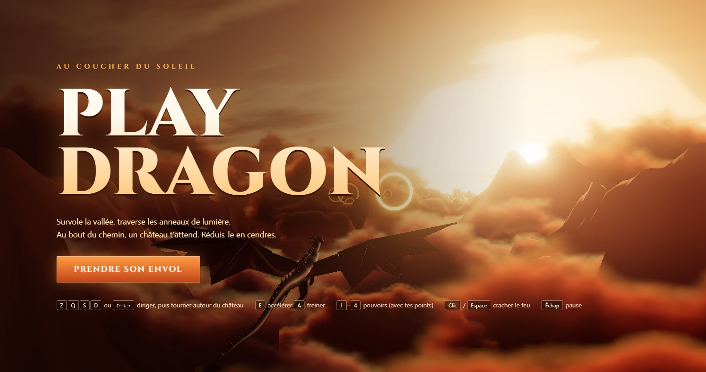
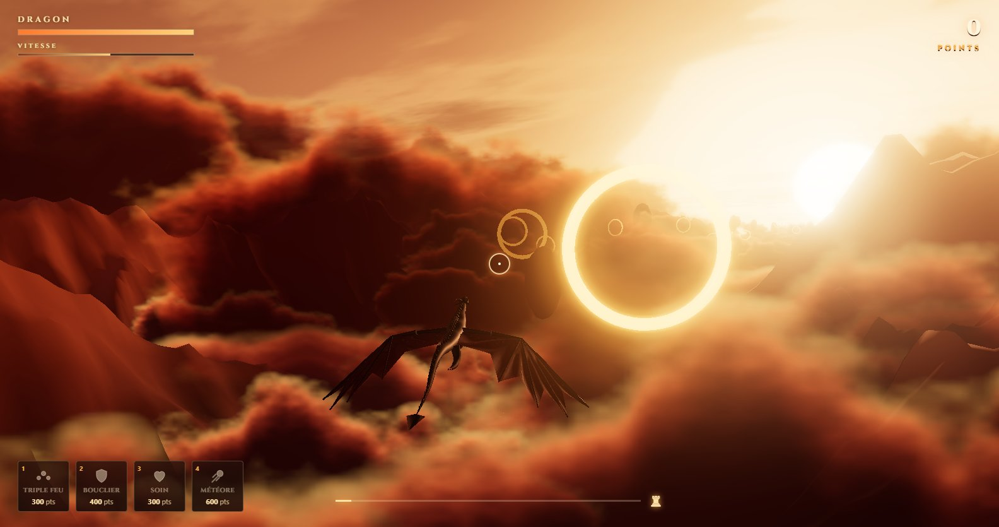

<h1 align="center">PlayDragon</h1>

<p align="center">
  <a href="https://github.com/raphaelmounirprivate-dot/PlayDragon/releases/latest/download/PlayDragon-Setup.exe">
    
  </a>
</p>

<p align="center">
  <b><a href="https://github.com/raphaelmounirprivate-dot/PlayDragon/releases/latest/download/PlayDragon-Setup.exe">⬇ Télécharger l'installeur (PlayDragon-Setup.exe)</a></b>
  &nbsp;·&nbsp;
  <a href="https://github.com/raphaelmounirprivate-dot/PlayDragon/releases/latest/download/PlayDragon.exe">version portable sans installation</a>
  &nbsp;·&nbsp;
  <a href="https://github.com/raphaelmounirprivate-dot/PlayDragon/releases/latest">toutes les versions</a>
</p>

<p align="center">
  
</p>

Un dragon survole une vallée au coucher du soleil, au-dessus d'une mer de nuages. Traverse les anneaux de
lumière, abats les gargouilles et évite les rochers flottants. Au bout du chemin, un château t'attend :
réduis-le en cendres avant que ses tours ne t'abattent.

## Installer

1. Clique sur **Télécharger le jeu** ci-dessus.
2. Lance `PlayDragon-Setup.exe`. Le jeu n'est pas signé, donc Windows SmartScreen peut afficher
   « Windows a protégé votre ordinateur » : clique sur **Informations complémentaires**, puis
   **Exécuter quand même**.
3. Suis l'installeur. Il crée un raccourci **PlayDragon** sur le bureau et dans le menu Démarrer. Pour
   désinstaller : Paramètres › Applications.

Tu préfères ne rien installer ? Prends la **version portable** (`PlayDragon.exe`) et lance-la directement.

<p align="center">
  
</p>

## Jouer

| Touche | Action |
|---|---|
| **Z Q S D** ou flèches | Diriger le dragon (clavier AZERTY) |
| **E** (ou Maj) / **A** | Accélérer / freiner |
| **Clic** ou **Espace** | Cracher une boule de feu (vise avec la souris) |
| **1 2 3 4** ou boutons en bas à gauche | Pouvoirs spéciaux, payés avec tes points |
| **Échap** | Pause |
| **F11** | Plein écran |

### Déroulement

1. **Le voyage** (environ 1 minute) : le dragon suit la rivière. Chaque anneau traversé rapporte
   100 points. Les rochers enlèvent 20 points de vie ; tu peux aussi les détruire en tirant dessus.
   Des **gargouilles** arrivent par vagues et foncent sur toi : abats-les au feu (150 points chacune), sinon
   leur choc enlève 10 points de vie.
2. **Le siège** : le château apparaît. **Q / D** pour en faire le tour (le dragon reste face à lui),
   **Z / S** pour monter ou descendre. Ses 6 tours et son donjon tirent des carreaux bleus : esquive-les en
   tournant. Chaque partie du château détruite rapporte 500 points.
3. **La victoire :** quand tout est détruit, les remparts s'effondrent.

### Pouvoirs spéciaux

Tes points sont aussi ta monnaie. Chaque pouvoir a un temps de recharge.

| Touche | Pouvoir | Coût | Effet |
|---|---|---|---|
| 1 | Triple feu | 300 | Pendant 8 s, chaque tir part en éventail de 3 boules de feu |
| 2 | Bouclier | 400 | Invulnérable pendant 6 s |
| 3 | Soin | 300 | Rend 40 points de vie |
| 4 | Météore | 600 | Une énorme boule de feu qui inflige 4 dégâts au château |

## Développer

Il faut Node.js 20 ou plus récent.

```bash
npm install
npm run dev          # http://localhost:5173
npm test             # tests unitaires
npm run dist         # produit release/PlayDragon-Setup.exe (installeur) et release/PlayDragon.exe (portable)
```

Les règles du projet, son architecture et les pièges d'installation sont décrits dans
[AGENTS.md](AGENTS.md).

## Technique

- **Three.js**, tout est procédural : aucune image ni aucun modèle 3D externe.
- Ciel en shader, avec soleil et bandes de nuages. Relief en bruit fractal, avec une vallée creusée le long
  de la rivière.
- Nuages peints par bruit, avec ombrage et liseré doré. Dragon généré par tubes à rayon variable. Ailes
  membraneuses déformées à chaque battement.
- Post-traitement : bloom, étalonnage chaud, vignettage, tone mapping ACES.
- **Electron** pour l'exe Windows.
